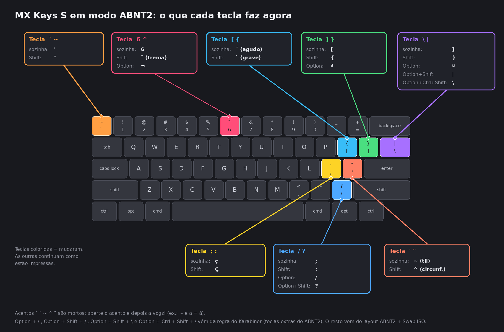

# Teclado americano com layout ABNT2 no Mac (Logitech MX Keys S)

Como usar um teclado **físico americano (ANSI)** no macOS digitando como um **ABNT2 brasileiro**: `ç`, acentos, `º`, `ª`, aspas, barras, tudo no lugar certo, sem precisar comprar um teclado ABNT2.

Testado com o **Logitech MX Keys S** (versão americana) no macOS, usando **Karabiner-Elements**.

---

## Como funciona

A solução tem 3 peças que trabalham juntas:

| # | Peça | O que resolve |
|---|------|---------------|
| 1 | **Layout ABNT2 do macOS** | Faz `ç`, `~`, `^`, `´`, `` ` ``, `[`, `]`, `;`, `:` etc. saírem nas teclas certas |
| 2 | **"Swap ISO layout-specific keys"** (Karabiner-Elements) | Corrige a tecla `` ` `` (aspas simples e duplas) |
| 3 | **Regras do Karabiner** (`mx-keys-s-abnt2.json`) | Recriam as 2 teclas extras do ABNT2 que o teclado americano não tem: `\ \|` e `/ ?` |

---

## Requisitos

- macOS
- Teclado americano (ANSI). Este guia usa o Logitech MX Keys S.
- [Karabiner-Elements](https://karabiner-elements.pqrs.org/) instalado (gratuito).

---

## Passo a passo

### 1. Instalar o Karabiner-Elements

1. Baixe em <https://karabiner-elements.pqrs.org/>.
2. Instale e abra o app.
3. Quando o macOS pedir, conceda as permissões: **Ajustes do Sistema → Privacidade e Segurança → Monitoramento de Entrada** e **Acessibilidade**, além de permitir a extensão de sistema do Karabiner. O próprio app guia você nessas telas.

### 2. Adicionar o layout ABNT2 no macOS

1. Abra **Ajustes do Sistema → Teclado → Fontes de Entrada → Editar…**
2. Clique em **+** e escolha **Português** → o layout **ABNT2** (o nome exato pode variar conforme a versão do macOS).
3. Adicione e, na barra de menus, **selecione esse layout** como o ativo.

### 3. Configurar o teclado no Karabiner

1. No Karabiner-Elements, vá em **Devices**.
2. Localize o seu teclado (ex.: **MX KEYS S (Logitech)**).
3. Deixe as opções assim:

| Opção | Estado |
|-------|--------|
| Modify events | **Ligado** |
| Treat as a built-in keyboard | Desligado |
| Disable the built-in keyboard while this device is connected | Desligado |
| Manipulate caps lock LED | Ligado |
| **Swap ISO layout-specific keys** | **Ligado** |
| Ignore vendor events | **Ligado** (recomendado para teclados que não são da Apple) |

> **Importante:** o **Modify events** precisa estar ligado para que as regras do próximo passo funcionem, e o **Swap ISO layout-specific keys** é o que acerta a tecla `` ` `` (aspas) no ABNT2.

### 4. Descobrir o `vendor_id` e o `product_id` do seu teclado

O arquivo de regras já vem com os IDs do **MX Keys S** (`vendor_id: 1133`, `product_id: 45944`). **Se o seu teclado for outro, troque esses números.**

Para descobrir os seus:

1. Abra o **Karabiner-EventViewer** (instalado junto com o Karabiner).
2. Vá na aba **Devices**.
3. Procure o seu teclado e anote o **vendor_id** e o **product_id**.

### 5. Importar as regras (teclas extras do ABNT2)

1. No Karabiner-Elements, vá em **Complex Modifications**.
2. Clique em **Add your own rule**.
3. Apague o conteúdo do editor e **cole o conteúdo do arquivo [`mx-keys-s-abnt2.json`](mx-keys-s-abnt2.json)**.
4. Se o seu teclado não for o MX Keys S, troque `product_id` e `vendor_id` (em todas as 4 regras) pelos valores do passo 4.
5. Clique em **OK**. A regra aparece na lista e já fica **ativa**.

> Quer que as regras valham para **qualquer** teclado? Remova o bloco `"conditions"` de cada regra. Atenção: isso também vale para o teclado interno do Mac.

### 6. Testar

Abra um editor de texto e confira a tabela abaixo. Se tudo saiu como esperado, está pronto.

---

## Mapa de teclas

Legenda: **Tecla** é a tecla física, com a legenda **impressa no teclado americano**.

### Layout ABNT2 do macOS (peça 1)

| Tecla | Sozinha | Shift | Option |
|-------|---------|-------|--------|
| `;` | `ç` | `Ç` | |
| `'` | `~` (til, tecla morta) | `^` (circunflexo, tecla morta) | |
| `[` | `´` (agudo, tecla morta) | `` ` `` (grave, tecla morta) | |
| `6` | `6` | `¨` (trema, tecla morta) | `¬` |
| `]` | `[` | `{` | `ª` |
| `\` | `]` | `}` | `º` |
| `/` | `;` | `:` | |

### Swap ISO do Karabiner (peça 2)

| Tecla | Sozinha | Shift |
|-------|---------|-------|
| `` ` `` | `'` (apóstrofo) | `"` (aspas) |

### Regras do Karabiner (peça 3)

São as teclas que **não existem** no teclado americano, mas existem no ABNT2:

| Combinação | Gera | Tecla extra do ABNT2 |
|------------|------|----------------------|
| `Option` + `/` | `/` | `/ ?` |
| `Option` + `Shift` + `/` | `?` | `/ ?` |
| `Option` + `Shift` + `\` | `\|` | `\ \|` |
| `Option` + `Ctrl` + `Shift` + `\` | `\` | `\ \|` |

> `Option`, `Ctrl` e `Shift` valem tanto do lado esquerdo quanto do direito.

### Teclas mortas (acentos)

`´` `` ` `` `~` `^` `¨` são **teclas mortas**: aperte o acento e **depois a letra**.

| Digite | Resultado |
|--------|-----------|
| `´` + `a` | á |
| `` ` `` + `a` | à |
| `~` + `a` | ã |
| `^` + `e` | ê |
| `¨` + `u` | ü |

Para escrever o sinal sozinho, aperte o acento e depois **Espaço**.

---

## Solução de problemas

**Uma regra não faz nada.**
Confira se o **Modify events** está ligado para o seu teclado e se o `vendor_id`/`product_id` do JSON são os do seu teclado (passo 4).

**A tecla sai diferente do esperado.**
Abra o **Karabiner-EventViewer**, aba **Main**, aperte a tecla e veja o `key_code` que o Karabiner enxerga. Isso mostra se o problema está na regra ou no layout.

**Os acentos saem errados ou a tecla `` ` `` não dá `'` e `"`.**
Verifique se o layout **ABNT2** é o ativo na barra de menus e se o **Swap ISO layout-specific keys** está ligado.

**Option + `\` gera `º`, e não `\`.**
É o comportamento esperado do ABNT2. A contrabarra `\` vem de **Option + Ctrl + Shift + `\`** (veja a tabela das regras do Karabiner).

**Outros símbolos com Option (`¹ ² ³ £ ¢` etc.).**
O layout ABNT2 do macOS usa o Option como AltGr. Confira o que cada tecla gera no **Visualizador de Teclado** (Ajustes do Sistema → Teclado → Fontes de Entrada → mostrar o Visualizador de Teclado).

---

## Arquivos deste repositório

| Arquivo | Descrição |
|---------|-----------|
| `README.md` | Este guia |
| `mx-keys-s-abnt2.json` | Regra para colar em *Complex Modifications → Add your own rule* |
| `teclado_abnt2_estilo_escuro.png` | Mapa visual das teclas |

---

## Créditos

- [Karabiner-Elements](https://karabiner-elements.pqrs.org/), de Takayama Fumihiko.
