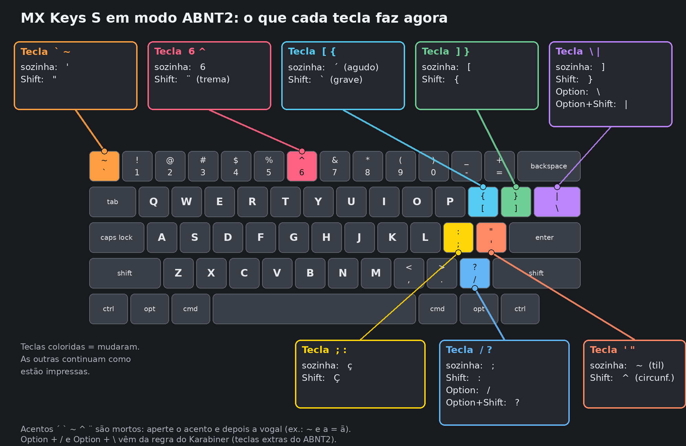

# Teclado Logitech MX Keys S (americano) com layout ABNT2 no Mac

Use um teclado **MX Keys S com teclas americanas (ANSI)** no macOS digitando como um **ABNT2 brasileiro**: `ç`, `~`, `´`, `^` e `¨` funcionando do jeito que você já conhece, sem precisar decorar combinações.



---

## Sumário

- [O problema](#o-problema)
- [A solução](#a-solução)
- [O que você precisa](#o-que-você-precisa)
- [Passo a passo](#passo-a-passo)
- [Mapa das teclas](#mapa-das-teclas)
- [Teclas extras com Option](#teclas-extras-com-option)
- [Resumo das configurações](#resumo-das-configurações)
- [Como funciona o código](#como-funciona-o-código)
- [Usando outro teclado](#usando-outro-teclado)
- [Problemas comuns](#problemas-comuns)
- [Arquivos deste repositório](#arquivos-deste-repositório)

---

## O problema

O teclado brasileiro (ABNT2) tem teclas que o teclado americano não tem:

- a tecla **`ç`**
- as teclas de acento **`~ ^`** e **`´` + `` ` ``**
- duas teclas extras: **`\ |`** (à esquerda do Z) e **`/ ? °`** (à direita do `;`)

No MX Keys S americano essas teclas não existem, e as outras ficam em posições diferentes. Se você escolher o layout ABNT2 no Mac sem ajustar nada, o `ç` e os acentos saem em teclas que não combinam com o que está impresso, e o `§` aparece à esquerda do `1`.

## A solução

1. Usar o layout nativo **Português – ABNT2** do macOS, com o tipo de teclado **ANSI**.
2. Usar o **Karabiner-Elements** para criar as duas teclas que faltam (`/ ?` e `\ |`), acessíveis com **Option**.

Resultado: o layout ABNT2 inteiro funciona, e as duas teclas extras ficam em **Option + `/`** e **Option + `\`**.

---

## O que você precisa

| Item | Para quê | Obrigatório |
|---|---|---|
| **macOS** | Layout ABNT2 nativo | Sim |
| **[Karabiner-Elements](https://karabiner-elements.pqrs.org)** | Criar as teclas `/ ?` e `\ \|` que o teclado americano não tem | Sim |
| **[Logi Options+](https://www.logitech.com/software/logi-options-plus.html)** | Teclas F, Easy-Switch e bateria do MX Keys S | Não |

O Logi Options+ **não é necessário** para o layout. Ele cuida das teclas de função e do Easy-Switch, e funciona junto com o Karabiner sem conflito.

---

## Passo a passo

### 1. Configurar o layout no macOS

1. Abra **Ajustes do Sistema → Teclado → Fontes de Entrada → Editar**.
2. Clique em **+**, escolha **Português** e adicione **Português – ABNT2**.
3. Remova os outros layouts (por exemplo, U.S.) para não alternar sem querer.
4. Em **Ajustes do Sistema → Teclado**, clique em **Alterar tipo de teclado…** e siga o assistente.
5. Quando o assistente perguntar, escolha **ANSI**.

> O tipo **ANSI** é o que evita o `§` aparecendo à esquerda do `1`.

### 2. Instalar o Karabiner-Elements

1. Baixe e instale em [karabiner-elements.pqrs.org](https://karabiner-elements.pqrs.org).
2. Abra o app e conceda as permissões que ele pedir:
   - **Ajustes do Sistema → Privacidade e Segurança → Monitoramento de Entrada**
   - **Extensões do sistema** (permita as do Karabiner)
3. Reinicie o Mac se o Karabiner pedir.

### 3. Configurar o teclado no Karabiner

1. No Karabiner, abra **Devices**.
2. Ache **MX KEYS S (Logitech)** e ligue **Modify events**.
3. Deixe **Swap ISO layout-specific keys desligado**.
4. Opcional: ligue **Ignore vendor events**, que o próprio Karabiner recomenda para teclados que não são da Apple.

### 4. Instalar o código

O código abaixo é a **regra completa**. É tudo o que você precisa colocar no Karabiner, de uma vez só.

**O que ele faz:** cria as duas teclas do ABNT2 que o teclado americano não tem, usando a tecla **Option**.

| Você aperta | Sai |
|---|---|
| `Option` + `/` | `/` |
| `Option` + `Shift` + `/` | `?` |
| `Option` + `\` | `\` |
| `Option` + `Shift` + `\` | `\|` |

A regra vale só para o **MX KEYS S**. O teclado do próprio Mac não é afetado.

**Como usar:**

1. Abra o **Karabiner-Elements** e vá em **Complex Modifications**.
2. Clique em **Add your own rule**.
3. Apague o que estiver na caixa de texto, cole o código abaixo e clique em **OK**.
4. A regra **MX Keys S: Option + / = / e ?; Option + \ = \ e |...** aparece na lista, ativada.

```json
{
    "description": "MX Keys S: Option + / = / e ?; Option + \\ = \\ e | (teclas extras do ABNT2)",
    "manipulators": [
        {
            "conditions": [
                {
                    "identifiers": [
                        {
                            "product_id": 45944,
                            "vendor_id": 1133
                        }
                    ],
                    "type": "device_if"
                }
            ],
            "from": {
                "key_code": "slash",
                "modifiers": { "mandatory": ["option", "shift"] }
            },
            "to": [
                {
                    "key_code": "international1",
                    "modifiers": ["left_shift"]
                }
            ],
            "type": "basic"
        },
        {
            "conditions": [
                {
                    "identifiers": [
                        {
                            "product_id": 45944,
                            "vendor_id": 1133
                        }
                    ],
                    "type": "device_if"
                }
            ],
            "from": {
                "key_code": "slash",
                "modifiers": { "mandatory": ["option"] }
            },
            "to": [{ "key_code": "international1" }],
            "type": "basic"
        },
        {
            "conditions": [
                {
                    "identifiers": [
                        {
                            "product_id": 45944,
                            "vendor_id": 1133
                        }
                    ],
                    "type": "device_if"
                }
            ],
            "from": {
                "key_code": "backslash",
                "modifiers": { "mandatory": ["option", "shift"] }
            },
            "to": [
                {
                    "key_code": "grave_accent_and_tilde",
                    "modifiers": ["left_shift"]
                }
            ],
            "type": "basic"
        },
        {
            "conditions": [
                {
                    "identifiers": [
                        {
                            "product_id": 45944,
                            "vendor_id": 1133
                        }
                    ],
                    "type": "device_if"
                }
            ],
            "from": {
                "key_code": "backslash",
                "modifiers": { "mandatory": ["option"] }
            },
            "to": [{ "key_code": "grave_accent_and_tilde" }],
            "type": "basic"
        }
    ]
}
```

> Prefere importar um arquivo? O [`mx-keys-abnt2.json`](mx-keys-abnt2.json) deste repositório contém exatamente a mesma regra.

### 5. Testar

Abra um editor de texto e confira:

| Digite | Deve sair |
|---|---|
| tecla `;` | `ç` |
| `Shift` + tecla `;` | `Ç` |
| tecla `'` e depois `a` | `ã` |
| `Option` + `/` | `/` |
| `Option` + `Shift` + `/` | `?` |
| `Option` + `\` | `\` |
| `Option` + `Shift` + `\` | `\|` |

Se quiser ver as teclas, ative o **Visualizador de Teclado** em **Ajustes do Sistema → Teclado → Fontes de Entrada → Mostrar menu de entrada na barra de menus**.

---

## Mapa das teclas

As teclas continuam com as letras americanas impressas, mas produzem o resultado do ABNT2:

| Tecla impressa | Sozinha | Com Shift | Observação |
|---|---|---|---|
| `` ` `` `~` | `'` | `"` | aspas simples e duplas |
| `6` `^` | `6` | `¨` | trema (acento morto) |
| `[` `{` | `´` | `` ` `` | acentos agudo e grave (mortos) |
| `]` `}` | `[` | `{` | |
| `\` `\|` | `]` | `}` | |
| `;` `:` | `ç` | `Ç` | |
| `'` `"` | `~` | `^` | til e circunflexo (mortos) |
| `/` `?` | `;` | `:` | |

As demais teclas (letras, números, `-`, `=`, `,` e `.`) continuam como estão.

**Acentos mortos:** aperte a tecla do acento e depois a vogal. Exemplos:

- `~` e `a` dá `ã`
- `´` e `e` dá `é`
- `^` e `o` dá `ô`
- `¨` e `u` dá `ü`

## Teclas extras com Option

O ABNT2 tem duas teclas que o MX Keys não tem. Elas foram criadas no Karabiner, usando **Option**:

| Combinação | Resultado |
|---|---|
| `Option` + `/` | `/` |
| `Option` + `Shift` + `/` | `?` |
| `Option` + `\` | `\` |
| `Option` + `Shift` + `\` | `\|` |

---

## Resumo das configurações

Tudo o que precisa estar configurado para funcionar:

| Onde | Configuração |
|---|---|
| macOS → Fontes de Entrada | Somente **Português – ABNT2** |
| macOS → Tipo de teclado | **ANSI** |
| Karabiner → Devices → MX KEYS S | **Modify events** ligado |
| Karabiner → Devices → MX KEYS S | **Swap ISO layout-specific keys** desligado |
| Karabiner → Devices → MX KEYS S | **Ignore vendor events** ligado (recomendado) |
| Karabiner → Complex Modifications | Regra **MX Keys S: Option + / = / e ?...** ativada |

O `ç`, os acentos e o resto das teclas vêm do layout **Português – ABNT2** do próprio macOS. Se houver outras regras do Karabiner ativas para este teclado (por exemplo, remapeamentos antigos de `;`, `'` ou `[`), desative-as, porque entram em conflito.

---

## Como funciona o código

O macOS trata o ABNT2 como um teclado com 105 teclas (ISO), e o MX Keys S americano tem 104 (ANSI). Faltam duas teclas, então a regra cria as duas usando **Option**.

Cada bloco do código faz uma coisa:

- `from`: a tecla que você aperta.
  - `"key_code": "slash"` é a tecla `/` do teclado americano.
  - `"mandatory": ["option"]` significa que o Option precisa estar apertado.
- `to`: o que o Mac recebe no lugar.
  - `international1` é o código da tecla `/ ?` do ABNT2.
  - `grave_accent_and_tilde` é o código da tecla `\ |` do ABNT2.
  - `"modifiers": ["left_shift"]` envia junto o Shift, para gerar `?` e `|`.
- `conditions`: a regra só vale para o **MX KEYS S**, identificado pelo `vendor_id` (1133, Logitech) e pelo `product_id` (45944). O teclado do próprio Mac não é afetado.

Cada tecla tem dois blocos: um com **Option + Shift** e outro só com **Option**. O bloco com Shift vem primeiro, para ser avaliado antes.

---

## Usando outro teclado

A regra está presa ao MX KEYS S pelos IDs. Para outro teclado americano:

1. No Karabiner, abra **Devices** e anote o **Vendor ID** e o **Product ID** do seu teclado.
2. Troque `1133` e `45944` na regra por esses números (em decimal).

Se o teclado for ANSI, o restante da regra funciona igual.

---

## Problemas comuns

**O `§` aparece à esquerda do `1`.**
O tipo de teclado ainda está como ISO. Refaça o passo 1 e escolha **ANSI**. Confirme também que **Swap ISO layout-specific keys** está desligado.

**A regra não faz nada.**
- Confirme que **Modify events** está ligado para o MX KEYS S em **Devices**.
- Confirme que o Karabiner tem as permissões de Monitoramento de Entrada e a extensão do sistema liberada.
- Veja se a regra está ativa em **Complex Modifications**.
- Reinicie o Karabiner.

**O Option + `/` não gera `/` nem `?`.**
O layout ABNT2 do Mac tem um atalho nativo para teclados sem essa tecla: **Option + Q** gera `/` e **Option + W** gera `?`. Você pode usar esses atalhos ou trocar o `to` dos dois primeiros blocos da regra por:

```json
{ "key_code": "q", "modifiers": ["option"] }
```
(sem Shift) e
```json
{ "key_code": "w", "modifiers": ["option"] }
```
(com Shift).

**O Option + `\` gera `'` ou `"`.**
O `to` está com `non_us_backslash`. Use `grave_accent_and_tilde`, como na regra deste repositório.

**Estou com outro idioma/layout ativo.**
Deixe apenas **Português – ABNT2** em **Fontes de Entrada**, para o Mac não trocar de layout sozinho.

---

## Arquivos deste repositório

| Arquivo | Descrição |
|---|---|
| `README.md` | Este guia |
| `mx-keys-abnt2.json` | Regra do Karabiner pronta para importar |
| `mapa-teclado-mx-keys-abnt2.png` | Mapa visual das teclas |

---

## Observações

- Feito e ajustado para o **Logitech MX Keys S** (layout americano).
- O Option + `/` e o Option + `\` dependem de como o macOS interpreta o teclado. Se algo sair diferente no seu Mac, ajuste conforme a seção [Problemas comuns](#problemas-comuns).
- Contribuições e correções são bem-vindas.
